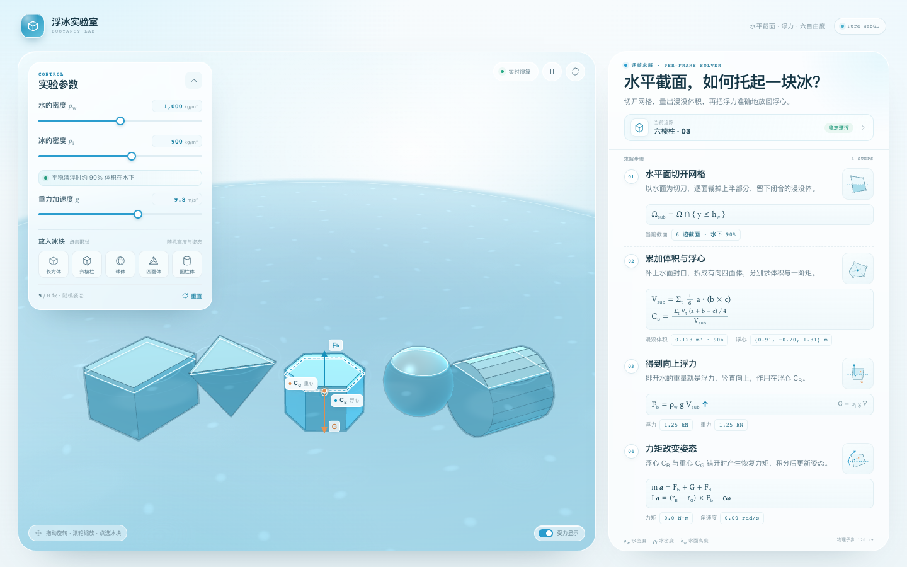

# 浮冰实验室 · Buoyancy Lab



**在线体验：<https://pilotphil.github.io/load-forecast/buoyancy/>**

一个不依赖任何第三方库的实时 3D 浮力实验。水面由世界坐标中的平面 `y = h_w` 表示，每帧对冰块网格做水平裁剪，再根据闭合面片的体积与一阶矩求出浸没体积和浮心，随后求解六自由度刚体方程。

## 功能

- 5 种冰块形状：长方体、六棱柱、球体、四面体、圆柱体
- 多个冰块同时仿真，初始高度与姿态随机
- 调整水密度、冰密度和重力加速度
- 选中任意冰块，查看浸没体积、浮心、浮力、重力、力矩和角速度
- 力矢量、浮心 / 重心和水线截面均实时绘制
- 右侧 4 步公式讲解全部跟随当前选中冰块更新
- 纯 WebGL + SVG/DOM 覆盖层，没有构建步骤，没有 CDN 或第三方运行时

## 本地运行

ES modules 需要通过 HTTP 访问：

```bash
cd buoyancy_web
python3 -m http.server 4173
```

打开 <http://127.0.0.1:4173>。

在本仓库中部署在 `/load-forecast/buoyancy/`，直接访问上面的在线地址即可。

## 核心实现

- `src/shapes.js`：随机凸多面体网格、体积质心、惯性张量与平面着色数据
- `src/physics.js`：水平面逐面裁剪与封口、有向四面体求和、浮力 / 重力 / 阻尼、四元数姿态积分
- `src/renderer.js`：手写 WebGL 1 渲染器、环形水面、环带接触阴影、轮廓线与相机
- `src/app.js`：场景编排、交互与实时读数

物理子步固定为 120 Hz。流体作用采用简化模型：浮力、重力、速度阻尼与角阻尼；这是面向交互演示的近似，不是 CFD 求解器。


顶栏右侧保留了一个「← 主页」链接，点击返回个人主页的冰载荷预报 tab。
