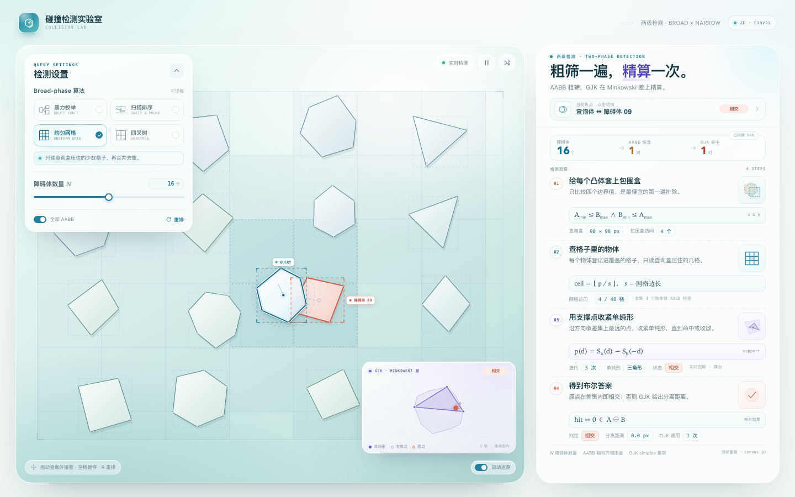

# 碰撞检测实验室 · Collision Lab



**在线体验：<https://pilotphil.github.io/load-forecast/collision/>**

一个纯原生 JavaScript + Canvas 2D 的二维碰撞检测演示。左侧是实时检测场景，右侧是四步求解流程：**Broad-phase** 用 AABB 和空间结构缩小候选，**Narrow-phase** 用 GJK 在 Minkowski 差上给出精确判定。

没有第三方库，没有构建步骤，没有 CDN，也不加载外部字体或图片。整个页面可以直接放在 GitHub Pages 仓库根目录。

## 功能

- **四种 Broad-phase 算法可切换**：暴力枚举、扫描排序（Sweep & Prune）、均匀网格、四叉树。
- **Narrow-phase 使用 2D GJK**：实时展示支撑点、单纯形状态和迭代次数；分离时还会给出两个凸多边形的最短距离。
- **两级检测可视化**：AABB、候选对、GJK 命中对、当前焦点对，以及每种空间结构自己的图示（网格、四叉树节点、x 扫描带、暴力测试连线）。
- **交互式查询体**：拖动查询体观察结果；自动巡游会在“相交”和“近失”之间往返，交替展示两个阶段。
- **实时读数**：检测漏斗、当前焦点、查询 AABB、结构访问量、GJK 迭代、单纯形、分离距离。
- **响应式布局**：桌面为左右双栏，平板/手机自动变为上下排列；窄屏下设置面板默认收起。
- 所有物体、AABB、辅助线和 Minkowski 图都由 Canvas 手绘；图标是内联 SVG。

## 本地运行

ES modules 需要通过 HTTP 打开：

```bash
cd collisionDetection_web
python3 -m http.server 4174
```

访问 <http://127.0.0.1:4174>。

在本仓库中部署在 `/load-forecast/collision/`，直接访问上面的在线地址即可，不需要构建。

## 操作

| 操作 | 效果 |
| --- | --- |
| 拖动查询体 | 接管移动并实时更新检测结果 |
| 点击“当前焦点” | 在多个候选对之间切换 |
| `空格` | 暂停 / 继续 |
| `1`–`4` | 切换 Broad-phase 算法 |
| `R` | 重排场景 |
| `A` | 开关自动巡游 |
| 右下角开关 | 自动巡游 / 手动控制 |

## 实现结构

- `index.html` — 页面结构、控件、步骤文案
- `styles.css` — 响应式布局与视觉样式
- `src/geometry.js` — 凸多边形、AABB、支撑点、Minkowski 差凸包
- `src/broadphase.js` — 四种 broad-phase 查询结构，统一返回 AABB 候选
- `src/gjk.js` — 2D GJK：支撑函数、单纯形约简、相交判定与分离距离
- `src/renderer.js` — 主舞台与 Minkowski 内嵌图的 Canvas 绘制
- `src/app.js` — 场景编排、自动巡游、拖拽、读数与交互

## 技术说明

- **单查询模型**：场景是「一个可拖动的查询体 vs N 个缓慢旋转的障碍体」。每帧重建空间结构，所有算法返回的候选集必须与暴力 AABB 结果完全一致；差异只体现在结构访问量上。
- **GJK**：在 Minkowski 差 `A ⊖ B` 上迭代支撑点，用「原点到单纯形最近点」的 GJK 变体同时得到布尔结果和分离距离。没有使用 SAT 作为运行时窄相，也没有 EPA。
- **Minkowski 差**：对两个凸多边形的顶点两两求差后做凸包，得到精确的差集多边形；GJK 的支撑点和最终单纯形直接叠加在这个差集上。
- **单位**：舞台内的长度单位是 CSS 像素；右侧显示的分离距离就是这两个凸多边形的真实最短距离。
- **纯 2D**：没有 3D 相机、没有 WebGL，也没有任何外部运行时。

为了方便复现截图，页面支持几个可选 URL 参数：`?algo=grid&n=16&seed=20261111&still=1`。`still=1` 会暂停自动巡游并冻结画面。


顶栏右侧保留了一个「← 主页」链接，点击返回个人主页的冰载荷预报 tab。
